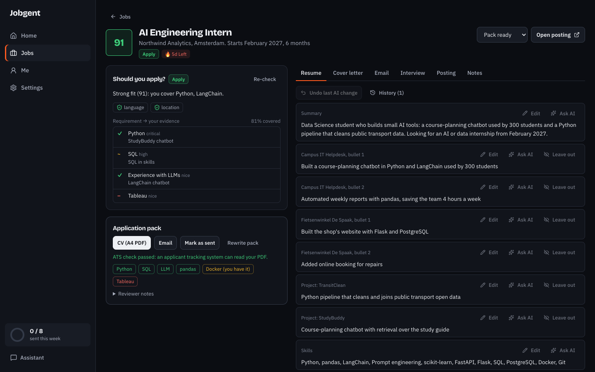
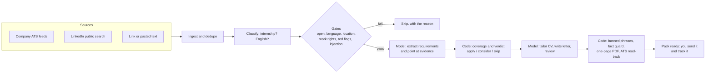
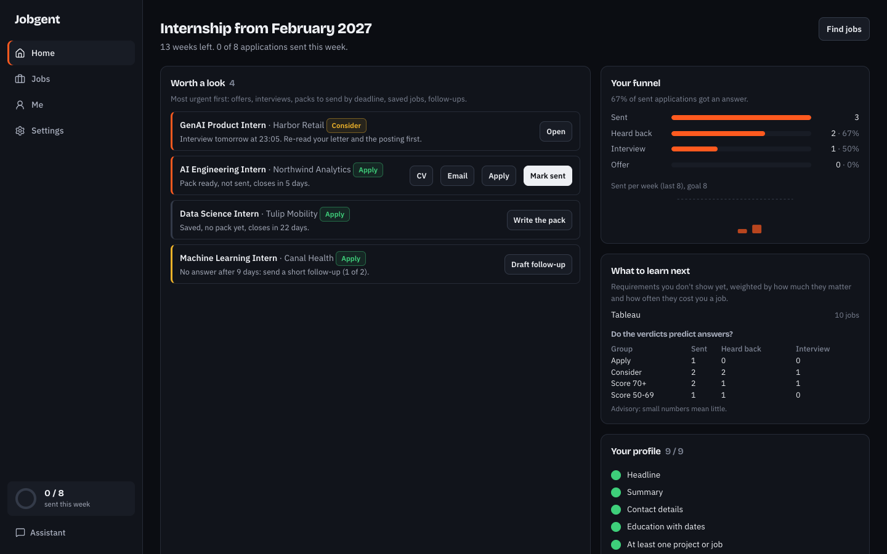
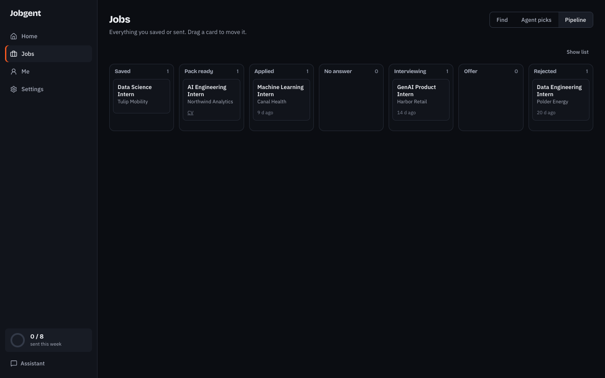
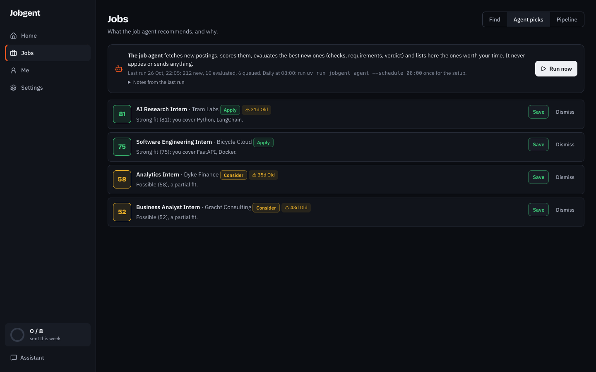
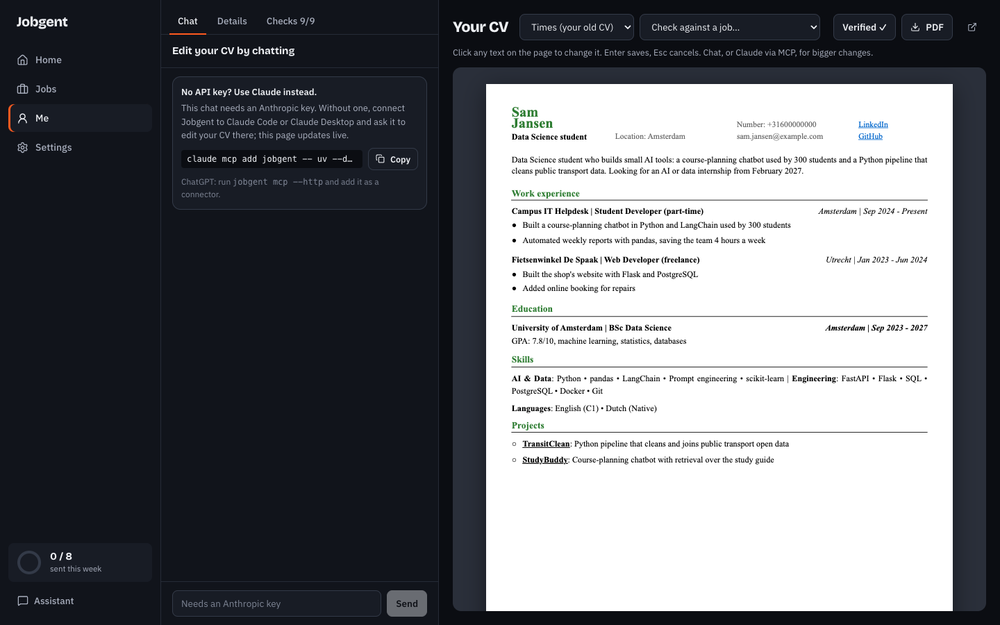

# Jobgent

**An open-source AI job search engine you run yourself.** Jobgent finds jobs, tells you which are worth your time and why, writes a tailored one-page CV and cover letter for each, and tracks every application. All of it from a web app, a CLI, or any AI agent over MCP.

It starts where its author needed it: internships for international students in the Netherlands, in English. The engine is general (search keywords, cities and dates are settings in your own profile), and the job sources are a list you can extend.

[](https://github.com/Oxde/jobgent/actions/workflows/ci.yml)




> **The model judges, code decides.** The AI reads postings and drafts documents. Plain code decides the verdict, the coverage, what counts as evidence, and whether a document is safe to send. You submit every application yourself.

## Try it in two minutes (no API key)

```bash
git clone https://github.com/Oxde/jobgent && cd jobgent
uv sync && uv run playwright install chromium
(cd frontend && npm ci --ignore-scripts && npm run build)
uv run jobgent demo                                  # a made-up student with 10 jobs
JOBGENT_HOME=~/.jobgent-demo uv run jobgent web       # http://127.0.0.1:8781
```

The demo is entirely fictional (Sam Jansen, generic companies) and never touches your real data in `~/.jobgent`.

## What it does

| | |
|---|---|
| **Finds jobs** | 70+ company job boards read straight from their public ATS feeds (Greenhouse, Lever, Recruitee, Ashby, Workable, Homerun), LinkedIn's public job search, and any link or pasted posting. Duplicates across sources are merged. |
| **Judges fit** | Hard gates first: still open, language, location, work rights, red flags (fees, unpaid roles) and prompt injection in the posting. Then every requirement is mapped to evidence in your profile, and code decides *covered / partial / gap* and the verdict *apply / consider / skip*. |
| **Writes the pack** | A CV tailored per job (which projects and skills, in which order), a cover letter in your voice and tone, and the email. A second model pass reviews it. One A4 page, guaranteed. |
| **Refuses to lie** | A number that is not in your profile or the posting blocks the pack. Unknown names are flagged "check this". Banned filler phrases are rewritten. Every AI edit is versioned with undo. |
| **Checks the PDF like an ATS** | Reads the PDF's text layer back: contact details present, dates parseable, keywords found, keywords you have but left out, and real gaps. |
| **Tracks the search** | Drag-and-drop pipeline, a "worth a look" home ordered by urgency (offers, interviews, deadlines, follow-ups after 7 days), a funnel and weekly goal, interview prep with STAR stories, and "what to learn next" from your most common gaps. |
| **Runs as an agent** | A daily job agent fetches, evaluates and queues the best new matches, with the reason for each pick. |

## How it works



Every model output is a typed schema (pydantic), so a model can only fill in fields; it cannot change the rules. Posting text is sanitized and fenced before any prompt sees it, so a posting that says "ignore your instructions" gets flagged instead of obeyed.

## Use it from your AI agent

Jobgent is MCP-first: every feature is a tool, so Claude Code, Claude Desktop, Cursor or ChatGPT can drive the whole search by conversation.

```bash
claude mcp add jobgent -- uv --directory /ABSOLUTE/PATH/jobgent run jobgent mcp
uv run jobgent mcp --http        # port 8790, for ChatGPT connectors and other remote clients
```

Then just talk: *"Find AI internships in Amsterdam starting February"*, *"Is job 42 worth applying to?"*, *"Make the pack for 42 in a direct tone"*, *"Make my second bullet shorter"*, *"What should I learn next?"*. The web app updates live while the agent edits.

**No API key? Let your agent do the AI part.** With `evaluate_prompt` / `evaluate_submit` and `pack_prompt` / `pack_submit`, Jobgent hands the agent the profile, the posting, the rules and the output format; the agent writes; Jobgent still runs every check (gates, verdict, fact guard, one-page PDF, ATS read-back) before anything is saved. Your Claude or ChatGPT subscription does the writing, and Jobgent stays the referee.

<details>
<summary>All MCP tools</summary>

| Area | Tools |
|---|---|
| Profile and CV | `profile_get`, `profile_update`, `profile_add_item`, `profile_remove_item`, `profile_set_verified`, `profile_get_voice`, `profile_set_voice`, `profile_notes_append`, `profile_set_master_cv`, `profile_import_jobkiller`, `cv_outline`, `cv_export_pdf`, `cv_writing_guide` |
| Jobs | `jobs_search`, `jobs_fetch`, `jobs_list`, `job_get`, `job_add`, `job_score`, `job_evaluate` |
| Agent mode | `evaluate_prompt`, `evaluate_submit`, `pack_prompt`, `pack_submit` |
| Packs | `pack_create`, `pack_get` |
| Tracking | `application_set_status`, `applications_list`, `stats` |
| Agent and insights | `agent_run`, `agent_queue`, `learning_gaps`, `interview_prep` |

</details>

## Set up for real

```bash
cp .env.example .env     # fill in what you have
uv run jobgent init
uv run jobgent web
```

| Variable | What it does |
|---|---|
| `ANTHROPIC_API_KEY` | Claude for matching, CVs and letters. |
| `KIE_API_KEY` | Alternative: Claude through [KIE](https://kie.ai). Used when no Anthropic key is set. |
| `APIFY_TOKEN` | Optional. LinkedIn through an Apify actor. Without it, LinkedIn's free guest search is used. |
| `JOBGENT_LINKEDIN` | `auto` (default), `apify`, `guest` or `off`. |
| `JOBGENT_HOME` | Where your data lives. Default `~/.jobgent`. |

With no AI key at all, search, tracking and the editor still work, and an MCP agent can do the AI steps (see above).

Your profile (`~/.jobgent/profile/profile.yaml`) is the single source of truth. Edit it on the **Me** page: the CV is a live A4 page you edit in place, next to a chat that edits it for you. Nothing personal is stored in this repository.

<details>
<summary>CLI</summary>

```bash
uv run jobgent init
uv run jobgent profile verify
uv run jobgent search "AI intern" --location Amsterdam
uv run jobgent fetch            # all sources → classify → score
uv run jobgent jobs --min-score 60
uv run jobgent pack 42
uv run jobgent status 42 applied
uv run jobgent stats
uv run jobgent agent            # one run of the daily job agent; --schedule 08:00 prints a launchd job
uv run jobgent companies        # check every board in data/companies.yaml
uv run jobgent eval             # run the golden evals against the live model
uv run jobgent web | mcp | demo
```

</details>

## Quality

- **250 tests** that need no network and no API keys (`uv run pytest -q`), and `mypy --strict` on the whole package.
- **Golden evals**: 10 hand-written postings in [`evals/golden/`](evals/golden) cover a strong fit, Dutch required, Dutch as a plus, the wrong city, an unpaid role, an agency fee, a prompt injection, a critical gap, a weak fit and a closed posting. Tests replay recorded model output; `jobgent eval` runs them against the live model.
- **Security**: link fetching blocks private addresses and re-checks every redirect (SSRF), secrets are never logged or returned by the API, and posting text is treated as data, never as instructions. See [SECURITY.md](SECURITY.md).

## Screenshots

| Home | Pipeline |
|---|---|
|  |  |
| **Agent picks** | **CV editor** |
|  |  |

## Stack

Python 3.12 (uv), FastAPI, SQLAlchemy + SQLite, pydantic, FastMCP, Typer, Playwright for PDFs. React 19, Vite, Tailwind 4, dnd-kit. Claude (Anthropic API or KIE) as the model.

## Agent skills

`.agents/skills/` holds skills that coding agents load when working in this repo. `jobgent-cv-writing` (ours) overrides the rest: facts only from the profile, never an estimated number, gaps stated honestly. The others come from [ResumeSkills](https://github.com/Paramchoudhary/ResumeSkills) by Param Choudhary (MIT), [anthropics/skills](https://github.com/anthropics/skills) (`frontend-design`) and [ui-ux-pro-max](https://github.com/nextlevelbuilder/ui-ux-pro-max-skill) (MIT). `skills-lock.json` pins them.

## Roadmap

- Indeed and a generic careers-page reader for companies without a public ATS feed.
- Import a profile from a CV PDF.
- More countries and languages.
- A hosted version for students who don't want to run it locally.

Ideas, bug reports and job boards are welcome: see [CONTRIBUTING.md](CONTRIBUTING.md). Adding a company is a one-line change.

## Credits

Ideas for the evaluation and the pack were studied from [career-ops](https://github.com/career-ops-hq/career-ops), [ai-job-search](https://github.com/ai-job-search-dev/ai-job-search) and Dossier. The design history is in [`docs/design/`](docs/design).

## License

[MIT](LICENSE) © Oxde
